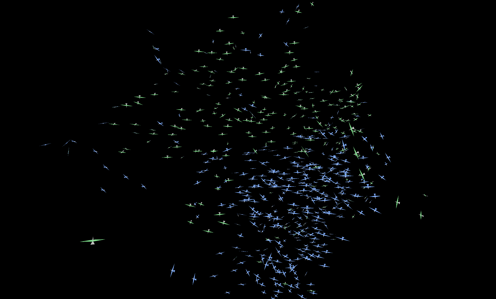



"in the stackyard there was a great murmuration of starlings"\
— Mary Webb

I don't know what a stackyard is, but there are three ways to run this.

(The app automatically adjusts the bird count depending on frame rate, so it should work reasonably well on a wide range of hardware.)

### Option 1: Single Click

If you have a GPU, [click here](https://natewaddoups.github.io/murmuration/?initial=500) to run it in your web browser with 500 birds.

If you don't have a GPU, [click here instead](https://natewaddoups.github.io/murmuration/?initial=100) to start with 100 birds.

In the browser, use `?initial=100` to set the starting bird count (default: 100). You'll notice a `current` query parameter that gets updated as the population changes; it is ignored at startup.

The population will only grow to 1500 birds at most, but that limit was added purely for aethetic reasons. You can start with larger populations if you're curious. An RTX 3080 will support roughly 12,000 birds at 60hz, but the flock looks like a blur, and spends a lot of time flying in circles.

### Option 2: Windows Screen Saver 

* Click the latest release (see the sidebar on the right).
* Download the .scr file.
* Copy it to any directory.
* Right-click the file in Explorer, and pick "Install" from the popup menu (if there is no Install option, dismiss the menu and right-click the file again).
* Open the Windows screen saver UI, and pick Murmuration from the list.

### Option 3: Command Line

You can also invoke the .scr file just like an .exe file, because every .scr file is actually an .exe file in disguise.

# Development Notes

### Command Line

Invoke `.\run.ps` to build and run as a Windows executable.

Invoke `.\run-web.ps` to build and run in a browser.

### Windows Screen Saver

Build a portable, self-contained Windows x64 package with:

```powershell
.\publish-screensaver.ps1
```

The screen saver is written to `artifacts/screensaver/win-x64/Murmuration.scr` as a self-contained executable. In File Explorer, right-click it and choose **Install**. Windows opens Screen Saver Settings; select **Murmuration** in the screen-saver list, set the wait time, and click **Apply**. If the Install command is unavailable, dismiss the menu and right-click again (I suspect this is a Windows bug). To uninstall it, choose another screen saver first, then delete the installed `Murmuration.scr`.

The saver covers connected displays and exits on keyboard input, mouse-button input, or deliberate pointer movement. Windows hosts the preview; the configuration command currently displays an informational dialog. To run it without installing, launch `Murmuration.scr /s` from the output folder.

The normal desktop app can be compiled and run by running `run.ps1`.

### Implementation Details

Bird initialization, neighbor selection, and flight updates run in parallel on the WebGPU device, with bird state kept on the GPU between frames. If the compute pipeline cannot be created, the simulation falls back to the CPU while WebGPU continues to render. Frame timing and the adaptive bird count remain on the CPU. GPU and CPU runs use the same flock rules but can produce different trajectories.

The GPU bird layout and simulation constants are generated from C#; the shared compute shader implements the simulation rules in WGSL. WebGPU is still required for rendering.

The GPU version is mostly just a parallel implementation, and it gets updated automagically via instructions in AGENTS.md. This is admittedly hacky. 

#### Tests

Run the test suite with `dotnet test src/Murmuration.Desktop.Tests/Murmuration.Desktop.Tests.csproj`. On Windows, the GPU tests use an available WebGPU adapter for shader compilation, readback comparisons, and rendering.

To compare 120 fixed-population frames at 400 and 1,024 birds in Release mode, set `$env:MURMURATION_BENCHMARK = '1'` and run `dotnet test src/Murmuration.Desktop.Tests/Murmuration.Desktop.Tests.csproj -c Release --filter FullyQualifiedName~SimulationShaderMatchesCpuForOneStep --logger 'console;verbosity=detailed'`. The GPU time includes command submission and a final readback; it is not a GPU timestamp measurement. Remove the environment variable afterward with `Remove-Item Env:MURMURATION_BENCHMARK`.

# Ideas for the future

* ~~Coordinated turns~~ (done)
* ~~Try averaging alignment with a few nearby birds instead of just the nearest neighbor.~~ (done)
* ~~Move simulation logic onto the GPU~~ (done)
* ~~Flapping wings when climbing~~ (done)
* ~~Make the initial bird count configurable for the screen saver~~ (done)
* Generate the GPU implementation from C#, rather than relying on AI to keep it in sync with the C# implementation.
* Give the birds better geometry (they're rather flat)
* Tune the behavior further 

# Origins

This is an itch that I've been wanting to scratch for a long time.  Flock simulation dates back to at least 1986, when Craig Reynolds published his *Boids* paper at [SIGGRAPH](https://en.wikipedia.org/wiki/SIGGRAPH). I wrote one in college several years later, which was deeply disappointing due to the lack of computing power - a couple dozen "birds" in two dimensions just isn't that interesting. 

So every time I get a new PC I've wondered about how much better it could do, but it was never a high enough priority to actually make it happen. Then I realized that I could vibe-code the basics in an evening (the boring part), and then iterate on the behavior for days (the fun part). So here we are.

# About That Quote

Merriam-Webster attributes that quote to Mary Webb.

The resemblance between those names is rather suspicious.
