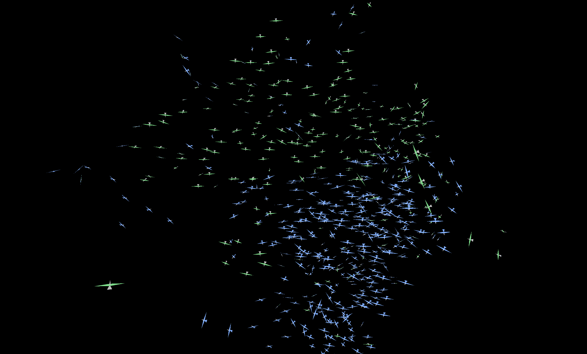

# Murmuration

"in the stackyard there was a great murmuration of starlings"\
— Mary Webb

[Click here](https://natewaddoups.github.io/murmuration/) to run it in your web browser.

This is an itch that I've been wanting to scratch for a long time.  Flock simulation dates back to at least 1986, when Craig Reynolds published his *Boids* paper at [SIGGRAPH](https://en.wikipedia.org/wiki/SIGGRAPH). I wrote one in college several years later, which was deeply disappointing due to the lack of computing power - a couple dozen "birds" in two dimensions just isn't that interesting. 

So every time I get a new PC I've wondered about how much better it could do, but it was never a high enough priority to actually make it happen. Then I realized that I could vibe-code the basics in an evening (the boring part), and then iterate on the behavior for days (the fun part). So here we are.

I haven't done any real optimization yet, but a decent laptop can render a flock of 300-400 birds. It will automatically adjust the bird count depending on frame rate, so it should work reasonably well on a wide range of hardware. 



### Windows Screen Saver

Build a portable, self-contained Windows x64 package with:

```powershell
.\publish-screensaver.ps1
```

The screen saver is written to `artifacts/screensaver/win-x64/Murmuration.scr` as a self-contained executable. In File Explorer, right-click it and choose **Install**. Windows opens Screen Saver Settings; select **Murmuration** in the screen-saver list, set the wait time, and click **Apply**. If the Install command is unavailable, copy `Murmuration.scr` to `%WINDIR%\System32` (administrator permission may be required), then select it in Screen Saver Settings. To uninstall it, choose another screen saver first, then delete the installed `Murmuration.scr`.

The saver covers connected displays and exits on keyboard input, mouse-button input, or deliberate pointer movement. Windows hosts the preview; the configuration command currently displays an informational dialog. To run it without installing, launch `Murmuration.scr /s` from the output folder.

The normal desktop app remains available by running `run.ps1`.

### Ideas for the future

* Flapping wings when climbing
* ~~Coordinated turns~~ (done)
* ~~Try averaging alignment with a few nearby birds instead of just the nearest neighbor.~~ (done)
* Give the birds better geometry (they're rather flat)
* Add UI to adjust behavior
* Move simulation logic onto the GPU
* ???

### About That Quote

Merriam-Webster attributes that quote to Mary Webb.

The resemblance between those names is rather suspicious.
